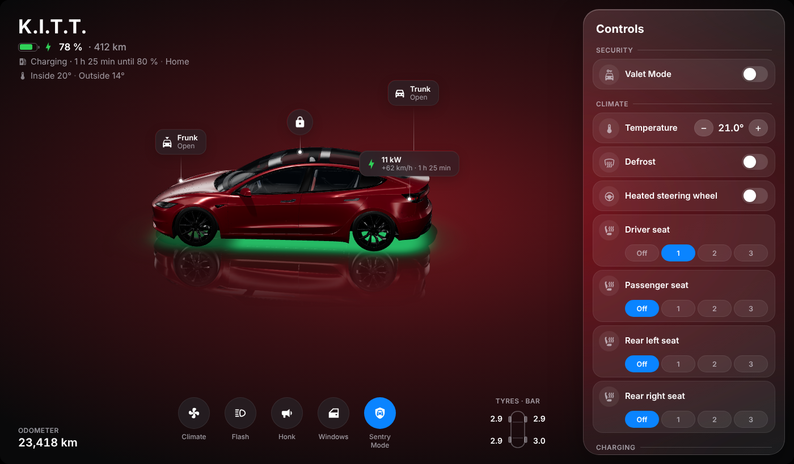

# Garage for Tesla

A 3D dashboard card for Home Assistant that puts your Tesla front and centre: a real 3D model on a glass floor, tinted to match your paint, with the car's status where it belongs and every control one tap away.

> **Not affiliated with Tesla, Inc.** "Tesla", "Model 3" and "Model Y" are trademarks of Tesla, Inc. This is a free community project.



## What you get

- **3D car** you can rotate, with a reflective glass floor and a background that matches your paint colour.
- **Information on the car itself**: lock state on the roof, frunk and trunk at each end, charging power at the charge port, tyre pressures on a top-down view, battery and range in the header.
- **Live effects on the 3D car**: charging light under the car, energy added written on the floor next to the car while the cable is plugged in, Sentry Mode scan, open doors/frunk and low tyres blinking orange, heated seats and heated steering wheel blinking red, ventilated seats blinking blue.
- **Controls menu on the right**, grouped like iOS Settings: security, climate, charging, doors & windows, quick actions. You choose which ones appear.
- **Shortcut row** under the car (lights, horn, climate, windows, frunk… you pick).
- Light and dark mode (follows Home Assistant or set it yourself), Portuguese and English.
- Safety prompts before unlocking or opening the frunk/trunk.
- Ventilated front seats (Tessie, Teslemetry, Tesla Custom Integration): tap the seat icon to switch between heating and ventilating; the icon shows which one the level buttons will use.

## Works with

The card does not log in to Tesla. It reads the entities that your Tesla integration already created in Home Assistant and finds them automatically:

| Integration | Status |
|---|---|
| [Tessie](https://www.home-assistant.io/integrations/tessie) | Tested |
| [Teslemetry](https://www.home-assistant.io/integrations/teslemetry) | Supported (same entity keys) |
| [Tesla Fleet](https://www.home-assistant.io/integrations/tesla_fleet) | Supported (same entity keys) |
| [Tesla Custom Integration](https://github.com/alandtse/tesla) | Best effort (matched by entity name) |
| [TeslaMate](https://docs.teslamate.org/docs/integrations/home_assistant) | Read only (no buttons): information only, see below |

The card editor shows which car and which integration the card is using, under the **Car** field.

### TeslaMate

TeslaMate can create the car in Home Assistant by itself (MQTT discovery, see the [TeslaMate docs](https://docs.teslamate.org/docs/integrations/home_assistant)). The card then finds it like any other Tesla:

- **TeslaMate only**: you get the 3D car with battery, range, charging, doors, frunk/trunk, tyres, temperatures and location. TeslaMate cannot send commands to the car, so there are no buttons.
- **TeslaMate and another integration** (for example Tesla Fleet): pick the car from the other integration under **Car** and the TeslaMate car under **TeslaMate data**. The information comes from TeslaMate, which updates more often; the buttons keep using the other integration.

```yaml
type: custom:garage-for-tesla-card
device_id: 0123456789abcdef            # the car from Tesla Fleet, Tessie, Teslemetry…
teslamate_device_id: fedcba9876543210  # the car created by TeslaMate
```

If something isn't detected, you can point the card to the right entity with `entities:` (see below).

<!-- ha-marketplace:exclude-start -->
## Install

**Home Assistant 2026.11 or newer**

1. Settings → Marketplace → search for **Garage for Tesla** and install it.
2. Reload the browser when asked.

Not in the search results yet? Settings → Marketplace → **Add from link** and paste `https://github.com/diogopires21-alt/garage-for-tesla`.

**Older versions of Home Assistant**: the card is also in the community store that the Marketplace replaced. Search for **Garage for Tesla** under *Dashboard*.
<!-- ha-marketplace:exclude-end -->

## Add it to a dashboard

The best fit is a dashboard (or view) in **Panel** mode so the card fills the screen:

1. Create a new dashboard, open a view, set the view type to **Panel (single card)**.
2. Add card → **Garage for Tesla**. Your car is picked automatically.

Minimal YAML:

```yaml
type: custom:garage-for-tesla-card
```

All options:

```yaml
type: custom:garage-for-tesla-card
device_id: 0123456789abcdef          # optional, first Tesla car found if empty
teslamate_device_id: fedcba987654321 # optional, the TeslaMate car: information comes from it (see TeslaMate above)
name: K.I.T.T.                       # optional, defaults to the device name
car_model: model3_highland           # model3_highland, model3_classic, modely_juniper, modely_classic
color: pearl_white                   # only colours that exist for the chosen model (see below)
interior: white                      # white or black
theme: auto                          # auto (follow HA), light, dark
shortcuts: [flash, honk, climate, windows, frunk]
menu: [lock, sentry, climate, defrost, seat_fl, seat_fr, charge, charge_port, charge_limit, frunk, trunk, windows, flash, honk]
height: 720px                        # optional, full height by default
confirm: true                        # ask before unlock / frunk / trunk
feedback: true                       # false hides "Suggest an idea" and "Report a problem" at the end of the menu
entities:                            # optional overrides
  battery: sensor.my_car_battery
```

Models and colours (only real factory colours for each one):

| `car_model` | Car | Colours |
|---|---|---|
| `model3_highland` | Model 3 (2024+) | `pearl_white`, `stealth_grey`, `quicksilver`, `diamond_black`, `solid_black`, `ultra_red`, `deep_blue`, `marine_blue` |
| `model3_classic` | Model 3 (2017–2023) | `pearl_white`, `midnight_silver`, `silver_metallic`, `solid_black`, `deep_blue`, `red_multicoat` |
| `modely_juniper` | Model Y (2025+) | `pearl_white`, `stealth_grey`, `quicksilver`, `diamond_black`, `solid_black`, `ultra_red`, `glacier_blue`, `deep_blue`, `marine_blue`, `frost_blue`, `coastal_blue` |
| `modely_classic` | Model Y (2020–2024) | `pearl_white`, `midnight_silver`, `stealth_grey`, `quicksilver`, `solid_black`, `deep_blue`, `red_multicoat`, `ultra_red`, `midnight_cherry` |

Control keys (for `shortcuts:`, `menu:` and `entities:`): `lock, sentry, valet, climate, defrost, steering_heat, steering_level, seat_fl, seat_fr, seat_rl, seat_rr, charge, charge_port, charge_limit, charge_amps, frunk, trunk, windows, flash, honk, wake, homelink, boombox, keyless`.

### Info keys

The card finds these sensors by itself with Tessie, Teslemetry, Tesla Fleet and the Tesla Custom Integration. It also finds them in the car that TeslaMate creates. If yours come from somewhere else (for example Fleet Telemetry over MQTT), point the card to them under `entities:` with the keys below. Use the entity type shown: the card reads the state exactly as described.

| Key | Entity | What the card expects |
|---|---|---|
| `battery` | `sensor` | Battery level in % |
| `range` | `sensor` | Range, with its unit (km or mi) |
| `charging` | `sensor` | Charging state as text: `charging`, `starting`, `complete`, `stopped`, `disconnected` (any case) |
| `charge_power` | `sensor` | Charging power (kW), shown at the charge port while charging |
| `charge_rate` | `sensor` | Charging speed (km/h or mi/h). Not shown yet |
| `time_to_full` | `sensor` | When charging ends: a date/time (`device_class: timestamp`) or minutes left (or hours, with unit `h`) |
| `energy_added` | `sensor` | Energy added in this session (kWh), written on the floor next to the car while the cable is plugged in |
| `cable` | `binary_sensor` | Charge cable plugged in: `on` = plugged, `off` = not plugged. **Not** `charge_port`: that one is the charge port door control (a `cover`) |
| `odometer` | `sensor` | Odometer, with its unit |
| `inside_temp`, `outside_temp` | `sensor` | Temperatures in °C or °F |
| `tpms_fl`, `tpms_fr`, `tpms_rl`, `tpms_rr` | `sensor` | Tyre pressure (front left, front right, rear left, rear right), with its unit (bar or psi) |
| `tpms_warn_fl`, `tpms_warn_fr`, `tpms_warn_rl`, `tpms_warn_rr` | `binary_sensor` | Low tyre pressure warning: `on` = low |
| `shift` | `sensor` | Gear: `P`, `R`, `N`, `D` (any case). `D`, `R` or `N` shows "Driving" |
| `speed` | `sensor` | Speed, with its unit, shown while driving |
| `location` | `device_tracker` | `home` or `not_home`. Any other zone name is shown as it is |
| `online` | `binary_sensor` | Car awake: `on` = awake, `off` = asleep |
| `update` | `update` | Software update: `on` = an update is available |
| `door_df`, `door_dr`, `door_pf`, `door_pr` | `binary_sensor` | Doors (driver front, driver rear, passenger front, passenger rear): `on` = open |

Example with the charge cable and the location set by hand:

```yaml
type: custom:garage-for-tesla-card
entities:
  cable: binary_sensor.my_car_charge_cable    # on/off sensor, not the charge port door
  location: device_tracker.my_car_location   # home / not_home
```

## Ideas and problems

At the end of the controls menu there are two links, **Suggest an idea** and **Report a problem**. They open a form on GitHub with the card version already filled in (for problems also the 3D model, the integration, the Home Assistant version and the browser or app). The card sends nothing by itself: you see everything first and you decide whether to submit it. Your car's name, licence plate, location and entity names are not included.

You can also [open the forms here](https://github.com/diogopires21-alt/garage-for-tesla/issues/new/choose).

## Credits

3D models (compressed for the web, rotated and with renamed materials; the paint and seats are recoloured at runtime):

- Model 3 (2024+): ["2024 Tesla Model 3"](https://sketchfab.com/3d-models/2024-tesla-model-3-fd22be415215453693d67e33aa7812d0) by **RBLXSupercars**, [CC BY 4.0](https://creativecommons.org/licenses/by/4.0/).
- Model 3 (2017–2023): ["Tesla M3 model"](https://sketchfab.com/3d-models/tesla-m3-model-3a602469d7874d1397efa67182198705) by **wintrez**, [CC BY 4.0](https://creativecommons.org/licenses/by/4.0/).
- Model Y (2025+): ["2025 Tesla Model Y"](https://sketchfab.com/3d-models/2025-tesla-model-y-619601e7800d418da5922c4fa7833f74) by **BloxBloger**, [CC BY-NC 4.0](https://creativecommons.org/licenses/by-nc/4.0/). **Non-commercial use only**: you can use it freely at home, but not in anything sold or used commercially.
- Model Y (2020–2024): ["Tesla Model Y 2021"](https://sketchfab.com/3d-models/tesla-model-y-2021-c0a86cac582d4b33aba0fb1b1912d970) by **763468712**, [CC BY 4.0](https://creativecommons.org/licenses/by/4.0/). Modified: paint holes and inward-facing panels fixed, glass made see-through, a centre screen added, and the mesh simplified.

Other:

- 3D engine: [three.js](https://threejs.org) (MIT).
- Font for the energy on the floor: [Inter](https://github.com/rsms/inter) Light by The Inter Project Authors, [SIL Open Font License 1.1](third-party/Inter-OFL.txt) (only the characters it needs are embedded).
- Code: [MIT licence](LICENSE). The 3D models and the font keep their own licences: see [third-party](third-party/README.md).

## Roadmap

- More 3D models (Model S, Model X, Cybertruck) so you can pick yours.
- Open windows shown on the 3D model.
- Map card with the car's location.
